<picture>
  <source media="(prefers-color-scheme: dark)" srcset="assets/header-dark.svg" />
  
</picture>

 

I design and build production AI systems end to end: LLM applications, agents, retrieval, speech and vision, and the data and cloud platforms they run on. My focus is systems that are measurable, secure and owned by the teams that use them, with evaluations built in from day one.

  
  
  

---

### What I work on

| | |
|---|---|
| **LLM Applications & Agents** | Copilots, multi-step agents, MCP servers, AI gateways |
| **Retrieval & Enterprise Search** | RAG pipelines, vector search, connectors to business systems |
| **Speech & Vision** | Speech recognition, custom voices, OCR, image understanding |
| **Model Optimisation** | Fine-tuning, distillation into small task models, inference optimisation |
| **Evaluation & Governance** | Evals and guardrails, EU AI Act readiness, secure-by-default design |
| **Platforms & MLOps** | Data and AI platforms, cloud landing zones, LLMOps, self-hosted inference |

### Technology

<picture>
  <source media="(prefers-color-scheme: dark)" srcset="assets/stack-dark.svg" />
  
</picture>

Most client work is under NDA and lives in private repositories.
